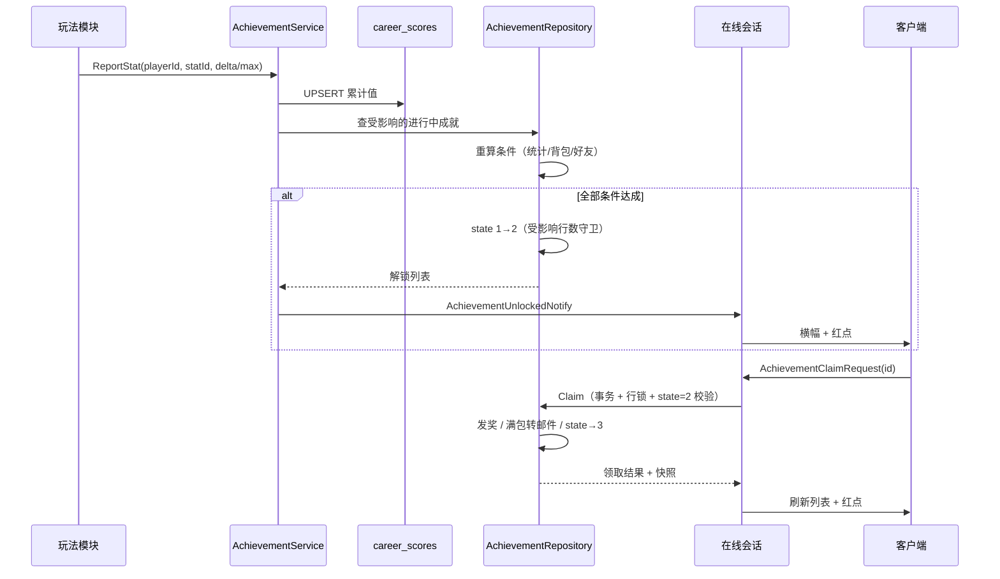

# 成就系统设计方案

> 版本：v1（待评审）
> 日期：2026-10-26
> 参考：B 站《讲解游戏抽卡系统设计逻辑》同作者的《游戏成就系统开发思路》转写稿
> 关联系统：任务系统（25xx）、生涯统计（`career_scores`）、背包（24xx）、邮件（26xx）、副本（28xx）、活动/唤取/签到（29xx）
> 结论先行：**项目目前有一套“任务内嵌成就”（6 条，生涯分数驱动），但还不是独立成就系统。建议新建独立 Achievement 模块，迁移旧成就，首期覆盖服务端已权威的 9 类玩法事件。**

---

## 0. 一句话结论

现有成就 = 任务系统的一个分类（`category=3`），只能表达“某个生涯指标 ≥ 目标值”，成就定义、玩家进度、领取状态都寄生在 `quest_config / player_quests` 里；它做对了“服务端权威 + 事务领取 + 解锁/领取分离”，但缺少**独立定义表、事件驱动条件、系列/点数/隐藏、专属 UI 与解锁反馈、历史回填**。本方案给出一个与任务系统解耦、可配置扩展的成就模块。

---

## 1. 现状分析

### 1.1 已有实现（证据）

| 能力 | 现状 | 证据 |
|---|---|---|
| 成就定义 | 与任务共用 `quest_config`，`category=3` 表示成就 | `Database/QuestRepository.cs` L95-96、L233-260 |
| 条件类型 | 只有 `goal_type=6`（生涯分数），`param1=生涯指标ID`，`target=目标值` | `QuestRepository.cs` L92-93 |
| 生涯指标 | 5 个：累计挑战/累计消息/累计获得物品/累计提交任务/历史最高分 | `Database/CareerRepository.cs` |
| 成就激活 | 拉任务列表/提交任务时 `AutoActivateAchievements` 自动补“进行中”行，不进可接取池 | `QuestRepository.cs` L506-535、`QuestHandler.cs` L29 |
| 进度 | 生涯指标变化时 `OnCareerChanged` 实时重算并写 `player_quests.progress` | `QuestRepository.cs` L1085-1125 |
| 解锁/领取 | `state=2` 可领取、`state=3` 已领取；`submitted_at` 兼作领取时间 | `QuestRepository.cs` L625 起 |
| 领取幂等 | 事务 + `PlayerWriteLock` + `player_quests FOR UPDATE` + `UPDATE ... WHERE state<>3` 受影响行数守卫；满包转邮件 | `QuestRepository.cs` L625-805 |
| 客户端 | 任务面板 `QuestView` 内分“主线/支线/成就”三段，成就可领时按钮文案“领取奖励” | `QuestView.cs` L16-21、L334、L466 |
| 首批成就 | 6 条：4001/4002/4003 挑战链、4101 社交、4201 物品、4301 任务 | `QuestRepository.SeedQuestConfigs` |

### 1.2 对照视频五条原则

| 原则 | 现状评分 | 说明 |
|---|---|---|
| 玩法只报事实、成就系统统一判断 | ●●○ | 有统一漏斗 `QuestHandler.Raise*`，但事件只有 5 种，且成就判断仍写在任务仓库里 |
| 定义 / 玩家进度 / 解锁 / 领取分开存 | ●●○ | `quest_config` 与 `player_quests` 分了，但成就是任务的一种，缺少系列、点数、隐藏、多条件等定义字段 |
| 进度独立于界面、可从历史统计初始化 | ●●○ | 事件时写进度，不依赖打开面板；但新指标没有回填机制，且只有 5 个指标 |
| 已解锁与已领取分开，防重复发奖 | ●●● | `state=2/3` + 事务行锁 + 受影响行数守卫，是现有实现最扎实的部分 |
| 新增成就只加配置，新增条件才写处理器 | ●○○ | 加“生涯指标阈值”成就只需加配置；但无法表达“击杀 100 个某怪”“拥有 10 位好友”“同时满足 A 和 B”等条件 |

### 1.3 具体缺口

1. **没有独立成就域**：系列、稀有度、成就点、隐藏成就、排序、条件文案都没有地方存。
2. **条件表达力弱**：只有“生涯指标 ≥ 目标”，没有事件过滤（按敌人类型/卡池/物品）、持有数量、好友数量、多条件 AND、账号年龄。
3. **生涯统计覆盖不足**：
   - 副本击杀只记“获得物品”，不记“击杀数/击杀类型”；`DungeonHandler.cs` L96/L171 只调 `RaiseItemGained`。
   - 唤取只走 `GachaRepository.Draw`，**没有** `RaiseItemGained`（`ActivityHandler.HandleGachaDraw` L73-122），所以唤取到的物品不计入“累计获得物品”，也不触发收集类任务。
   - 签到、邮件领取只发物品，不记“签到天数/领取次数”。
   - PvP 对战结果、对话/探索进度服务端不可见。
4. **没有成就专属表现**：任务面板里只有一段列表；没有成就总览、完成度、成就点、系列筛选、隐藏成就 `???`、解锁横幅、可领取红点。
5. **任务入口红点被成就占用**：`QuestManager.SubmittableCount` 会把 `category=3` 的可领取成就算进任务红点。
6. **旧成就迁移没有方案**：直接新增独立系统会出现“任务面板里 6 条 + 成就面板里 6 条”双份。

---

## 2. 目标与非目标

### 2.1 目标

- 玩法模块只上报“发生了什么”，成就模块统一判断、解锁、推送。
- 成就定义、玩家进度、解锁状态、领取状态四层分离，且进度独立于界面持久化。
- 领取服务端权威、事务化、严格幂等；满包奖励转邮件不丢失。
- 新增普通成就只改配置；新增条件类型才写一个条件处理器。
- 首期覆盖服务端已经权威的玩法事件：挑战、聊天、好友、物品、任务、副本、唤取、签到、邮件。
- 旧 6 条成就无损迁移，任务面板与成就面板不重复。
- 有专属 UI：总览、系列分组、进度、奖励、领取、隐藏成就、解锁提示、红点。

### 2.2 非目标（首期不做）

- 不做成就点数消费/兑换商店（点数只做收集度展示）。
- 不做跨服/全服首杀、赛季成就、限时成就排行榜。
- 不做 PvP 胜负、对话分支、场景探索类成就（这些需要新的服务端权威事件或客户端上报协议）。
- 不做成就专属美术资源批量生产；首期用程序化徽章 + 稀有度色框，`icon` 字段预留。
- 不做“成就分享到聊天/世界频道”。

---

## 3. 方案对比与选型

| 方案 | 做法 | 优点 | 缺点 | 结论 |
|---|---|---|---|---|
| A. 扩展现有任务成就 | 给 `quest_config` 加 series/points/hidden/condition_type 等列，继续用 `player_quests` | 改动最小，复用领取事务与邮件溢出 | 成就与任务继续耦合；任务列表协议不断变胖；成就专属查询会污染任务仓库；多条件需要新表，等于半独立 | 不推荐 |
| B. 完全独立新模块，旧成就保留双轨 | 新表 + 新协议 + 新 UI，旧 6 条继续在任务面板 | 风险最低，可并行 | 玩家看到两套成就；红点/领取口径分裂；长期维护两套 | 不推荐 |
| **C. 独立成就模块 + 迁移旧成就（推荐）** | 新表 `achievement_*` / `player_achievements`，复用 `career_scores` 作为统计层、复用背包发放与邮件溢出；旧 6 条迁入并从任务配置移除 | 架构干净、扩展性好；统计层不重复造；旧数据可迁移；任务面板回归纯任务 | 需要一次迁移与 QuestView 清理；工作量中等 | **推荐** |

**选型：C。**

---

## 4. 总体架构

### 4.1 分层

```
┌────────────────────────────────────────────────────────────┐
│ 表现层  AchievementView / 红点 / 解锁横幅 / 入口按钮        │
├────────────────────────────────────────────────────────────┤
│ 协议层  AchievementPacket.proto（34xx）                     │
├────────────────────────────────────────────────────────────┤
│ 领域层  AchievementService（事件接收 / 条件判断 / 解锁）     │
│         AchievementRepository（定义 / 进度 / 领取事务）      │
├────────────────────────────────────────────────────────────┤
│ 统计层  career_scores（通用玩家统计：累计值 / 最大值）        │
│         实时查询：背包持有量、好友数量                       │
├────────────────────────────────────────────────────────────┤
│ 事件层  玩法模块只调 AchievementService.ReportXxx(...)       │
└────────────────────────────────────────────────────────────┘
```

**关键边界**

- 玩法模块**不写成就判断**，只调 `AchievementService.ReportStat/ReportEvent`。
- `AchievementService` 不直接碰网络，返回“变化/解锁列表”，由 `AchievementHandler` 推送。
- 成就定义是静态配置，走 10 秒 TTL 缓存（照 `QuestRepository` 的原子快照缓存）。
- 玩家进度只在事件/登录/打开面板时写，不依赖界面存在。

### 4.2 数据流



### 4.3 事件模型

首期事件源（全部为服务端已权威或可由服务端直接查询）：

| 事件 | 触发点 | 统计键（`career_scores.score_id`） | 说明 |
|---|---|---|---|
| 挑战完成 | `LeaderboardHandler.HandleScoreSubmit` → `RaiseChallengeScore` | 1 累计挑战次数；5 历史最高分 | 已有 |
| 发消息 | `ChatHandler` 私聊/世界 → `RaiseMessageSent` | 2 累计消息数 | 已有 |
| 获得物品 | 背包/邮件/任务/副本/签到 → `RaiseItemGained` | 3 累计获得物品数 | 已有；**唤取缺口需补** |
| 提交任务 | `QuestRepository.Submit` | 4 累计提交任务数 | 已有 |
| 加好友 | `FriendHandler.HandleFriendRespond` | 6 累计加好友数 | 新增统计（当前只推进任务） |
| 副本击杀 | `DungeonHandler.HandleKillReport` 成功 | 7 副本击杀总数；107+敌人类型 按类型击杀 | 新增 |
| 副本拾取 | `DungeonHandler.HandlePickup` 成功 | 8 副本拾取次数 | 新增 |
| 唤取 | `ActivityHandler.HandleGachaDraw` 成功且非重放 | 9 唤取总次数；10 唤取五星数 | 新增；同时补 `RaiseItemGained`（见下） |
| 签到 | `ActivityHandler.HandleSignInClaim` → `SignInRepository.Claim` 成功 | 11 累计签到天数 | 新增 |
| 邮件领取 | `MailHandler.HandleMailClaim` 成功 | 12 累计领取邮件数 | 新增 |

> 说明：`career_scores` 原语义是“生涯数据”，但表结构就是 `(player_id, score_id, value)` 的通用计数器，直接复用可避免再造一张统计表。文档与代码注释统一称它为“玩家统计数据（通用）”，`CareerRepository` 保留类名兼容任务系统。

**唤取接入的两个实现细节（必须一起改）**

1. `GachaRepository.DrawResultItem` 目前只有 `ItemId/Name/Rarity/IconKey/IsUp/IsPity/IsNew/PityKind`，**没有 roll 出的星级**（`Rarity` 是物品稀有度，不等于卡池星级）。五星统计需要给内部 record 增加 `Star` 字段（`Draw` 循环里已有 `effectiveStar`），并在 `ActivityHandler` 映射时使用。
2. 唤取发奖走 `GachaRepository.Draw` 内部的 `BagRepository.GrantIntoSlots`，**没有** `QuestHandler.RaiseItemGained`。需要在 `DrawResultItem` 上补 `Granted`（`GrantIntoSlots` 返回值 > 0），Handler 对每个 `Granted=true` 的结果调 `RaiseItemGained`；`DrawOutcome.Replayed=true` 时**不得**重复上报，否则重试会重复计数。

**统计 ID 规划**

| 区间 | 用途 |
|---|---|
| 1-99 | 核心累计/最大值（上面 12 个） |
| 100-199 | 参数化计数：`100 + 敌人类型`（如 101=拾金鼠、102=藏宝龟） |
| 200-299 | 参数化计数：`200 + 物品ID`（按物品获得数，首期不用，预留） |
| 300+ | 预留（赛季、活动） |

**不新增统计的实时条件**

- 持有物品数量：直接查 `player_items` 聚合（照 `QuestRepository.LoadItemTotals`）。
- 好友数量：直接查 `friendships` 中 `Status=1` 的双向行数（注意现有设计是双向各一行，计数需去重或按 `player_id` 方向）。

### 4.4 条件模型

一条成就 = 1..N 个条件，**默认全部满足（AND）**；未来可加 `condition_mode` 支持 OR。

| `condition_type` | 含义 | 参数 | 进度语义 |
|---|---|---|---|
| 1 | 统计值 ≥ 目标 | `param1=statId` | 累计值/最大值，单调不减 |
| 2 | 持有物品数 ≥ 目标 | `param1=itemId` | 实时值，可增可减；已解锁不回退 |
| 3 | 好友数 ≥ 目标 | 无 | 实时值 |
| 4 | 账号注册天数 ≥ 目标 | 无 | 实时值（`accounts.CreatedAt`） |
| 5 | 指定日期前注册 | `param1=yyyyMMdd` | 布尔型，用于纪念成就（预留） |

**多条件示例**：“全能冒险家” = 累计挑战 10 次 AND 累计消息 20 条 AND 好友 3 位，三条 `achievement_condition` 行。

**进度展示规则**

- 单条件：`progress/target` 即该条件当前值。
- 多条件：列表显示**第一个未完成条件**的 `当前/目标`；详情逐条显示 `✓ / 3/5`。
- 隐藏成就未解锁时列表显示 `???`、详情不可点；解锁后正常显示。

### 4.5 数据表

迁移文件：`competeserves/Server/Migrations/017_AddAchievements.sql`

```sql
-- 成就定义（静态配置）
CREATE TABLE IF NOT EXISTS `achievement_config` (
  `achievement_id`      INT          NOT NULL,
  `name`                VARCHAR(64)  NOT NULL,
  `description`         VARCHAR(255) NOT NULL DEFAULT '',
  `series`              VARCHAR(32)  NOT NULL DEFAULT '成长',
  `rarity`              INT          NOT NULL DEFAULT 1,   -- 1铜 2银 3金 4白金（用于边框/角标）
  `points`              INT          NOT NULL DEFAULT 0,   -- 成就点
  `hidden`              TINYINT      NOT NULL DEFAULT 0,   -- 1=未解锁前显示 ???
  `prev_achievement_id` INT          NOT NULL DEFAULT 0,   -- 阶段链：上一阶段领取后才激活
  `sort`                INT          NOT NULL DEFAULT 0,
  `enabled`             TINYINT      NOT NULL DEFAULT 1,
  PRIMARY KEY (`achievement_id`)
) ENGINE=InnoDB DEFAULT CHARSET=utf8mb4;

-- 成就条件（1..N，默认 AND）
CREATE TABLE IF NOT EXISTS `achievement_condition` (
  `achievement_id` INT          NOT NULL,
  `seq`            INT          NOT NULL,
  `condition_type` INT          NOT NULL,
  `param1`         INT          NOT NULL DEFAULT 0,
  `param2`         INT          NOT NULL DEFAULT 0,
  `target`         INT          NOT NULL DEFAULT 1,
  `text`           VARCHAR(128) NOT NULL DEFAULT '',        -- 服务端直接下发的条件文案
  PRIMARY KEY (`achievement_id`, `seq`)
) ENGINE=InnoDB DEFAULT CHARSET=utf8mb4;

-- 成就奖励
CREATE TABLE IF NOT EXISTS `achievement_reward` (
  `achievement_id` INT NOT NULL,
  `item_id`        INT NOT NULL,
  `count`          INT NOT NULL,
  PRIMARY KEY (`achievement_id`, `item_id`)
) ENGINE=InnoDB DEFAULT CHARSET=utf8mb4;

-- 玩家成就进度（不存在行 = 未激活/锁定）
CREATE TABLE IF NOT EXISTS `player_achievements` (
  `player_id`      INT      NOT NULL,
  `achievement_id` INT      NOT NULL,
  `state`          TINYINT  NOT NULL DEFAULT 1,  -- 1进行中 2已解锁待领取 3已领取
  `progress`       INT      NOT NULL DEFAULT 0,  -- 主条件当前值（列表显示）
  `unlocked_at`    DATETIME NULL,
  `claimed_at`     DATETIME NULL,
  PRIMARY KEY (`player_id`, `achievement_id`),
  KEY `idx_player_state` (`player_id`, `state`)
) ENGINE=InnoDB DEFAULT CHARSET=utf8mb4;
```

> `state=0` 不落库；没有行就是“锁定/未激活”。阶段链的下一阶段在上一阶段**领取后**才插行，避免玩家提前看到下一阶段进度。

### 4.6 状态机

```
（无行）--激活--> 进行中(1) --条件全达成--> 已解锁待领取(2) --领取--> 已领取(3)
     ^                  |                                          |
     |                  +--条件回退（持有类）--> 仍为进行中(1)      |
     |                                                             |
     +---------------- 阶段链：上一阶段领取后插下一阶段行 ----------+
```

- 累计类进度只增不减；持有类（物品/好友）可能回退，但**已解锁不回退**。
- 已领取是终态；重复领取返回“已领取”，不再发奖。
- 阶段链：`prev_achievement_id` 指向上一阶段，只有上一阶段 `state=3` 才激活下一阶段。

### 4.7 解锁与领取时序

**解锁（自动，无需客户端请求）**

1. 事件到达 → 更新统计。
2. 按索引找受影响的进行中成就（只查相关条件，不做全表扫描）。
3. 逐个重算条件；全部满足 → `UPDATE player_achievements SET state=2, unlocked_at=NOW(), progress=target WHERE player_id=? AND achievement_id=? AND state=1`。
4. 受影响行数 = 1 才推送 `AchievementUnlockedNotify`（并发重复事件不会重复推）。
5. 解锁不改变阶段链；下一阶段等领取。

**领取（显式请求）**

1. `AchievementClaimRequest{ achievement_ids[] }`。
2. `PlayerWriteLock.Acquire(playerId)` + 事务 + `BagRepository.LockPlayerRow`（照 `QuestRepository.Submit`）。
3. 逐条 `SELECT ... FOR UPDATE`，校验 `state=2`；已领取/未解锁返回明确文案。
4. 读取背包槽位 → `BagRepository.GrantIntoSlots` 发奖；放不下的记 overflow。
5. `UPDATE ... SET state=3, claimed_at=NOW() WHERE ... AND state=2`，受影响行数必须 =1。
6. overflow → `MailRepository.InsertOverflowMail`（同事务），事务后触发 `AgentReminderService.OnMailArrived`。
7. 提交事务；生涯 `ScoreItemGain` 累加实际发放数量（与任务奖励口径一致）。
8. 领取可能让“累计获得物品”达标 → 立即重算并补推 `AchievementUnlockedNotify`；响应里的 `cascaded_unlocks` 预留为空（客户端以 3405 为准）。
9. 返回发放明细、更新后的玩家成就快照、汇总。

> **实施口径**：`achievement_ids` 支持一次传多个（客户端“全部领取”一次发送全部可领取 ID），服务端在同一玩家写锁 + 同一事务内逐条校验/发奖/置已领取；全部失败则整单回滚，部分成功则返回实际领取列表与失败原因。`claim_all` 字段保留但当前不使用。

### 4.8 幂等与并发

| 场景 | 处理 |
|---|---|
| 同一成就重复领取 | 行锁 + `state=2` 校验 + `UPDATE ... AND state=2` 受影响行数；第二次返回“已领取”，零发奖 |
| 两条并发领取 | `PlayerWriteLock` 串行化 + 行锁，后到者看到 state=3 |
| 同一事件重复上报 | 统计层按现有玩法语义处理；首期不给所有事件加 request_id，已知风险见 §12 |
| 解锁重复推送 | `state=1 → 2` 的受影响行数守卫；并发只有一个推 |
| 满包 | 发奖走 `GrantIntoSlots` + overflow 转邮件，同任务奖励 |
| 客户端重试领取 | 幂等，可安全重试 |
| 服务端重启 | 进度/统计/领取状态全在 MySQL，无内存真相 |

### 4.9 历史初始化与回填

- 旧 5 个统计已在 `career_scores`，新系统直接读，无需回填。
- 新增统计（击杀/拾取/唤取/签到/邮件/加好友）从**上线时刻**开始累计；不做“从历史表反推”，因为：
  - 副本击杀、唤取五星、签到天数在旧表里没有完整记录（`gacha_records` 可反推部分，但口径不一致）；
  - 反推会让老玩家一上线就弹大量成就，体验突兀。
- 旧 6 条成就的玩家状态**必须迁移**（见 §8），否则已领取的会重新可领。
- 若将来需要“上线前历史也算”，在 `Migrations` 里写一次性 `INSERT ... SELECT` 回填，并在文档记录口径。

---

## 5. 协议设计

新增 `protobuf/protos/AchievementPacket.proto`，消息号 **3401-3408**（33xx 已被场景存档占用，34xx 空闲）。

```proto
syntax = "proto3";
package common.network;
option csharp_namespace = "Common.Network";

// 成就条件（服务端已按玩家计算 current）
message AchievementConditionInfo {
  int32  seq            = 1;
  int32  condition_type = 2;
  int32  param1         = 3;
  int32  param2         = 4;
  int32  target         = 5;
  int32  current        = 6;
  string text           = 7;   // 展示文案，服务端生成
}

message AchievementRewardInfo {
  int32  item_id = 1;
  int32  count   = 2;
  string name    = 3;
}

message AchievementCfgInfo {
  int32  achievement_id      = 1;
  string name                = 2;
  string description         = 3;
  string series              = 4;
  int32  rarity              = 5;
  int32  points              = 6;
  bool   hidden              = 7;
  int32  prev_achievement_id = 8;
  int32  sort                = 9;
  repeated AchievementConditionInfo conditions = 10;
  repeated AchievementRewardInfo    rewards    = 11;
}

// state: 1进行中 2已解锁待领取 3已领取；0=无行（客户端按锁定处理）
message PlayerAchievementInfo {
  int32 achievement_id = 1;
  int32 state          = 2;
  int32 progress       = 3;
  int32 target         = 4;
  int64 unlocked_at_ms = 5;
  int64 claimed_at_ms  = 6;
}

message AchievementSummary {
  int32 total         = 1;
  int32 unlocked      = 2;
  int32 claimed       = 3;
  int32 claimable     = 4;
  int32 points        = 5;
  int32 total_points  = 6;
}

message AchievementListRequest {}

message AchievementListResponse {
  bool   success = 1;
  string message = 2;
  repeated AchievementCfgInfo        configs      = 3;
  repeated PlayerAchievementInfo     achievements = 4;
  AchievementSummary                 summary      = 5;
}

message AchievementClaimRequest {
  repeated int32 achievement_ids = 1;   // 可一次传多个（全部领取）
  bool           claim_all       = 2;   // 预留；当前客户端直接传全部ID
}

message AchievementClaimResponse {
  bool   success = 1;
  string message = 2;
  repeated int32                 claimed_ids      = 3;
  repeated AchievementRewardInfo granted          = 4;
  repeated PlayerAchievementInfo achievements     = 5;
  AchievementSummary             summary          = 6;
  repeated AchievementCfgInfo    cascaded_unlocks = 7;  // 领取奖励引发的连锁解锁
}

message AchievementUnlockedInfo {
  int32  achievement_id = 1;
  string name           = 2;
  int32  points         = 3;
  int32  rarity         = 4;
}

message AchievementUnlockedNotify {
  repeated AchievementUnlockedInfo items   = 1;
  AchievementSummary               summary = 2;
}

message AchievementProgressNotify {
  repeated PlayerAchievementInfo achievements = 1;
  AchievementSummary             summary      = 2;
}

// GM/联调
message AchievementGmRequest {
  int32 achievement_id = 1;
  int32 progress       = 2;
  bool  unlock         = 3;
  bool  reset          = 4;
}

message AchievementGmResponse {
  bool   success = 1;
  string message = 2;
  repeated PlayerAchievementInfo achievements = 3;
  AchievementSummary             summary      = 4;
}
```

`MessageID.proto` 新增：

| 值 | 名称 | 用途 |
|---|---|---|
| 3401 | `AchievementListRequest` | 拉成就配置 + 玩家状态 + 汇总 |
| 3402 | `AchievementListResponse` | 同上响应 |
| 3403 | `AchievementClaimRequest` | 领取 |
| 3404 | `AchievementClaimResponse` | 领取结果 + 快照 |
| 3405 | `AchievementUnlockedNotify` | 解锁推送 |
| 3406 | `AchievementProgressNotify` | 进度推送（节流） |
| 3407 | `AchievementGmRequest` | GM 改进度/解锁/重置 |
| 3408 | `AchievementGmResponse` | GM 响应 |

生成：在 `protobuf/` 下跑 `build_proto.bat`，三端产物：
- `competeserves/Server/Generated/AchievementPacket.cs`
- `RedDotSystem-main/Assets/Game/Scripts/Generated/AchievementPacket.cs`
- `protobuf/output/csharp/...`

**兼容性**：全部是新增消息与新增字段，不影响现有 25xx/29xx。

---

## 6. 服务端实现

### 6.1 文件

| 文件 | 内容 |
|---|---|
| `Migrations/017_AddAchievements.sql` | 四张表 + 旧成就迁移 SQL |
| `Database/AchievementRepository.cs` | 定义加载/缓存、玩家状态、条件计算、解锁、领取事务、汇总、回填 |
| `Manager/AchievementService.cs` | 事件入口 `ReportStat/ReportEvent`、条件索引、解锁推送候选、连锁解锁 |
| `Handler/AchievementHandler.cs` | 3401/3403/3407 的消息处理与 3405/3406 推送 |
| `Handler/MessageHandler.cs` | 路由 34xx |
| `Program.cs` | `EnsureTable + SeedConfigs + MigrateLegacy + Backfill`，启动日志 |

### 6.2 `AchievementRepository` 关键方法

```csharp
public void EnsureTable();
public void SeedConfigs();                    // INSERT IGNORE，改配置=改库或改种子
public void MigrateLegacyAchievements();      // 旧 6 条 player_quests → player_achievements
public List<AchievementConfig> GetConfigs();  // 10s TTL 原子快照缓存
public Dictionary<int, PlayerAchievementRow> GetPlayerRows(int playerId);
public void EnsurePlayerRows(int playerId);   // 登录/列表/事件时补行（阶段链门控）
public List<AchievementUnlock> Evaluate(int playerId, IReadOnlyCollection<int> achievementIds);
public (bool Success, string Message, ClaimResult Result) Claim(int playerId, IReadOnlyList<int> ids);
public AchievementSnapshot BuildSnapshot(int playerId);
public AchievementSummary BuildSummary(int playerId);
```

### 6.3 `AchievementService` 事件入口

```csharp
// 统计值：delta 累加 / max 取大
public static void ReportStat(int playerId, int statId, int delta, bool max = false);

// 组合事件：一次更新多个统计 + 触发一次评估
public static void ReportChallengeScore(int playerId, int challengeId, int score);
public static void ReportMessageSent(int playerId);
public static void ReportItemGained(int playerId, int itemId, int units);
public static void ReportFriendAdded(int playerId);
public static void ReportDungeonKill(int playerId, int enemyType);
public static void ReportDungeonPickup(int playerId);
public static void ReportGachaDraw(int playerId, int count, int fiveStarCount);
public static void ReportSignIn(int playerId);
public static void ReportMailClaimed(int playerId, int count);
```

内部：
- 更新 `career_scores`（`CareerRepository.Add/SetMax`）。
- 用 `ConditionIndex`（`statId → achievementIds`、`itemId → achievementIds`、`friend → friendConditionIds`）找出候选。
- 只对 `state=1` 的行评估；评估时读取统计、背包聚合、好友数。
- 更新 `progress`（单条件/多条件取第一个未完成条件）。
- 解锁 + 返回列表；阶段链下一阶段在 Claim 后激活。

### 6.4 接入点（改动现有文件）

| 文件 | 改动 |
|---|---|
| `Handler/LeaderboardHandler.cs` | `RaiseChallengeScore` 后调 `AchievementService.ReportChallengeScore`（或让 `RaiseChallengeScore` 内部同时上报） |
| `Handler/ChatHandler.cs` | 两处 `RaiseMessageSent` 后上报 |
| `Handler/FriendHandler.cs` | 同意好友后双方 `ReportFriendAdded` |
| `Handler/DungeonHandler.cs` | 击杀成功 `ReportDungeonKill(enemyType)`；拾取成功 `ReportDungeonPickup`；保留现有 `RaiseItemGained` |
| `Handler/ActivityHandler.cs` | 唤取成功 `ReportGachaDraw(count, 五星数)`；**补 `QuestHandler.RaiseItemGained`**；签到成功 `ReportSignIn` |
| `Handler/MailHandler.cs` | 领取成功 `ReportMailClaimed` |
| `Database/QuestRepository.cs` | 提交任务已有 `ScoreQuestSubmit`/`ScoreItemGain`，补一次成就评估（或由 `RaiseCareerDelta` 统一接入） |
| `Database/CareerRepository.cs` | 新增统计 ID 常量 + 注释改为“通用统计” |

> 推荐把“生涯累加 + 成就评估”收敛到 `QuestHandler.RaiseCareerDelta/Max` 里，这样所有现有调用点自动接入成就，减少散落。但要注意 `QuestRepository.Submit` 内部直接调 `career.Add`（不在 `QuestHandler`），需要在 `Submit` 返回后由 `QuestHandler` 补一次 `AchievementService.ReportStat`，或者把 `CareerRepository` 包装成“写统计即通知成就”的门面。**建议**：新增 `PlayerStatsService.Add/SetMax` 作为唯一写入口，`CareerRepository` 只做 SQL；`QuestHandler.RaiseCareerDelta/Max` 与 `QuestRepository.Submit` 都走它。这样统计与成就永远一致。

### 6.5 性能

- 配置缓存 10s；条件索引在缓存重建时一起建。
- 事件只评估候选成就，不全表扫描。
- 玩家行数 ≤ 成就总数（首期约 30），单次评估开销可忽略。
- 进度更新用单条 `UPDATE`；解锁用受影响行数守卫；`AchievementProgressNotify` 按玩家 0.5s 节流（可选）。
- 领取是低频操作，事务内读背包槽位与任务提交同量级。

---

## 7. 客户端实现

### 7.1 文件

| 文件 | 内容 |
|---|---|
| `Assets/Game/Scripts/Generated/AchievementPacket.cs` | 协议生成 |
| `Assets/Game/Scripts/Network/ClientNetworkManager.cs` | 6 个事件 + 3 个发送方法 + 分发 case |
| `Assets/Game/Scripts/Achievement/AchievementManager.cs` | 单例：登录清理、拉列表、领取、缓存、汇总、红点 |
| `Assets/Game/Scripts/Achievement/AchievementView.cs` | `UIView` 面板 |
| `Assets/Game/Scripts/Achievement/AchievementToast.cs` | 解锁横幅（TopLayer，程序化） |
| `Assets/Game/Scripts/Achievement/Editor/AchievementViewBuilder.cs` | 菜单 `Tools/UI/构建 AchievementView 预制体` |
| `Assets/Game/UI/Achievement/AchievementView.prefab` | 生成产物 |
| `Assets/Game/Scripts/UI/Framework/UIViewBase/UIType.cs` | `AchievementView = 24`，`Max = 25` |
| `Assets/Game/UI/UIConfig.json` | 注册条目 |
| `Assets/Game/Scripts/UI/Home/HomeView.cs` + `HomeView.prefab` | 新增 `achievementButton` |
| `Assets/Game/Scripts/UI/Home/Editor/HomeViewBuilder.cs` / `HomeViewSkinBuilder.cs` | 入口按钮布局 |
| `Assets/Game/Scripts/Chat/RedDotKeys.cs` | `AchievementEntry = Key17` |
| `Assets/Game/Configs/RedDot/RedDotConfigAsset.asset` | 新增 Key17 节点（Number） |

### 7.2 数据流

- `AchievementManager` 在 `Start` 订阅：`AchievementListResponse`、`AchievementClaimResponse`、`AchievementUnlockedNotify`、`AchievementProgressNotify`、`LoginResponse`。
- 登录成功：清缓存 → 拉列表（点亮红点，不需要打开面板）。
- 打开面板：若有缓存先渲染，再后台拉一次；无缓存显示“读取中…”。
- 收到 `AchievementUnlockedNotify`：更新缓存 → 弹横幅 → 刷新红点；面板开着则刷新列表/详情。
- 收到 `AchievementProgressNotify`：静默更新缓存；面板开着则刷新当前可见行。
- 领取：按钮点击 → `Claim(id)` → 回执更新缓存 → 刷新红点 → 展示奖励提示。
- 断线：保留缓存，红点不清零；重连登录后重新拉取。

### 7.3 UI 布局

沿用现有深色 HUD 风格（`#262B33` 面板、`#2E333D` 子面板、金色 `#E8C46A` 强调、红色关闭键），1920×1080 参考分辨率，`NormalLayer`。

```
┌──────────────────────────────────────────────────────────────┐
│ 成就                                             [×]          │
│ 成就点 120 / 300    已解锁 12/30    可领取 3                  │
├──────────────────────────────────────────────────────────────┤
│ [全部] [战斗] [成长] [社交] [活动] [隐藏]                     │
├───────────────────────────┬──────────────────────────────────┤
│ 战斗                       │  挑战新秀            [金] 10点   │
│  ● 挑战新秀   2/5  10点    │  生涯累计完成 5 次挑战            │
│  ● 挑战狂人   0/20 20点    │  ─────────────────────────────    │
│ 成长                       │  条件                            │
│  ● 小有家资   18/30 10点   │   ✓ 累计挑战 5/5                  │
│ 社交                       │   ○ 累计消息 3/10                 │
│  ● 交个朋友   1/1  可领取  │  ─────────────────────────────    │
│                            │  奖励：治疗药剂 x2                │
│                            │  [ 领取奖励 ]                     │
└───────────────────────────┴──────────────────────────────────┘
```

- 左列：`VirtualScrollList` 分组列表（段头 28px、行 64px），行内：稀有度徽章（程序化圆/菱形 + 首字）、名称、`进度/目标`、点数、状态标签（进行中/可领取/已领取）。
- 右列：名称 + 系列/稀有度/点数、描述、条件清单（`✓`/`○` + 当前/目标）、奖励、领取按钮（仅 `state=2`）、解锁/领取时间。
- 顶部：成就点、已解锁/总数、可领取数；筛选 tabs。
- 隐藏成就：未解锁时列表行 `???`、详情不可点；解锁后正常。
- 空态：`暂无成就`；加载：`读取中…`；失败：`读取失败，请稍后重试`。
- 列表排序：可领取 → 进行中 → 已解锁未领取（同可领取）→ 已领取；组内按 `sort` 再按 ID。
- 一键领取：客户端收集全部 `state=2` 的 ID，**一次 3403** 发送；服务端同一事务逐条处理，返回实际领取列表与失败原因。按钮文案“全部领取（N）”。

### 7.4 解锁横幅

- 独立 `AchievementToast`（`TopLayer`，sort 高于普通面板，低于邀请弹窗/加载层），程序化构建，零美术依赖。
- 队列：一次推送多条时逐条 1.6s 展示；内容 `成就解锁 · 名称  +N 成就点`，稀有度色条。
- 面板打开时也弹（不阻塞操作，`raycastTarget=false`）。
- 收到推送时同时刷新红点。

### 7.5 红点

- `RedDotKeys.AchievementEntry = (ERedDotKeyType)17`。
- `RedDotConfigAsset.asset` 新增 Key17，类型 `Number`（与任务入口一致，数字直接显示）。
- 数值 = 可领取数（`state=2`）。
- 登录拉列表、解锁推送、领取回执三处刷新。
- 入口按钮挂 `RedDotItem`（Key17，`ExactMatch` + `Number`）。

### 7.6 入口

- `HomeView.EntryBar` 新增“成就”按钮，位置接在现有入口行末尾（与任务/邮件同款绿色按钮）。
- `HomeViewBuilder`/`HomeViewSkinBuilder` 同步生成，避免预制体手工改动丢失。
- `HomeView.OnAddListener` 绑定 `UIManager.Open(UIType.AchievementView)`。
- 新手引导 `GuideSteps` 可后续追加“成就”一步（首期不强制）。

---

## 8. 旧成就迁移

### 8.1 迁移映射

旧 6 条（`quest_config` `category=3`）→ 新 `achievement_config`，复用原 ID，便于状态迁移：

| ID | 名称 | 系列 | 点数 | 条件 | 奖励 |
|---|---|---|---|---|---|
| 4001 | 挑战新秀 | 战斗 | 10 | 统计 1 ≥ 5 | 1001 x2 |
| 4002 | 挑战狂人 | 战斗 | 20 | 统计 1 ≥ 20（prev=4001） | 1007 x3 |
| 4003 | 挑战大师 | 战斗 | 30 | 统计 1 ≥ 50（prev=4002） | 1017 x1 |
| 4101 | 社交达人 | 社交 | 10 | 统计 2 ≥ 10 | 1005 x2 |
| 4201 | 小有家资 | 成长 | 10 | 统计 3 ≥ 30 | 1006 x2 |
| 4301 | 任务大师 | 成长 | 10 | 统计 4 ≥ 3 | 1008 x2 |

### 8.2 状态迁移 SQL

```sql
-- 旧成就是 category=3 的 quest；先保证新定义已插入
INSERT INTO player_achievements (player_id, achievement_id, state, progress, unlocked_at, claimed_at)
SELECT pq.player_id, pq.quest_id,
       CASE pq.state WHEN 3 THEN 3 WHEN 2 THEN 2 ELSE 1 END,
       pq.progress,
       pq.finished_at,
       pq.submitted_at
FROM player_quests pq
JOIN quest_config qc ON qc.quest_id = pq.quest_id AND qc.category = 3
ON DUPLICATE KEY UPDATE
  state = GREATEST(player_achievements.state, VALUES(state)),
  progress = GREATEST(player_achievements.progress, VALUES(progress)),
  unlocked_at = COALESCE(player_achievements.unlocked_at, VALUES(unlocked_at)),
  claimed_at = COALESCE(player_achievements.claimed_at, VALUES(claimed_at));

-- 删除旧任务定义/奖励/玩家行，避免任务面板重复显示、避免成就重复发奖
DELETE FROM quest_reward WHERE quest_id IN (4001,4002,4003,4101,4201,4301);
DELETE FROM player_quests WHERE quest_id IN (4001,4002,4003,4101,4201,4301);
DELETE FROM quest_config WHERE quest_id IN (4001,4002,4003,4101,4201,4301);
```

> 迁移顺序：先插入新定义 → 迁状态 → 删旧任务。`SeedQuestConfigs` 里必须同步删除这 6 行，否则重启又会被 `INSERT IGNORE` 种回来。

### 8.3 客户端清理

- `QuestView.RebuildVisibleQuests` 的 `new[] { 1, 2, CategoryAchievement }` 改为 `{ 1, 2 }`；成就段自然消失。
- `QuestManager.SubmittableCount` 不再包含成就（迁移后没有 `category=3`，天然不包含）。
- `QuestManager.CategoryAchievement` 常量保留（兼容旧数据/回滚），但 UI 不再使用。
- 旧 `QuestView` 的成就详情分支（`career` 的 `CareerText`）可保留但不可达，或一并删除。

### 8.4 回滚

- 迁移前备份 `quest_config/quest_reward/player_quests` 三表（SQL 文件注释写明）。
- 回滚 = 恢复备份 + 删除 `achievement_*`/`player_achievements`。
- 因为领取状态是迁移过去的，回滚后不会重复发奖（旧表恢复原状态）。

---

## 9. 首期成就内容（建议 24 条）

> 只使用首期已有事件；数值可按运营调整，全部走配置。

### 战斗（7）

| ID | 名称 | 条件 | 点数 | 奖励 |
|---|---|---|---|---|
| 5001 | 首战告捷 | 挑战 1 次 | 5 | 1001 x2 |
| 4001 | 挑战新秀 | 挑战 5 次 | 10 | 1001 x2 |
| 4002 | 挑战狂人 | 挑战 20 次 | 20 | 1007 x3 |
| 4003 | 挑战大师 | 挑战 50 次 | 30 | 1017 x1 |
| 5002 | 百步穿杨 | 最高挑战分 ≥ 80 | 15 | 1007 x2 |
| 5003 | 神射手 | 最高挑战分 ≥ 95 | 25 | 1017 x1 |
| 5004 | 初入副本 | 副本击杀 1 只 | 5 | 1001 x2 |
| 5005 | 百人斩 | 副本击杀 100 只 | 20 | 1006 x2 |
| 5006 | 拾金者 | 副本拾取 50 次 | 15 | 1005 x3 |

### 成长（6）

| ID | 名称 | 条件 | 点数 | 奖励 |
|---|---|---|---|---|
| 4201 | 小有家资 | 累计获得物品 30 | 10 | 1006 x2 |
| 5101 | 富甲一方 | 累计获得物品 300 | 25 | 1006 x5 |
| 4301 | 任务大师 | 累计提交任务 3 | 10 | 1008 x2 |
| 5102 | 任务狂人 | 累计提交任务 20 | 25 | 1008 x5 |
| 5103 | 初露锋芒 | 账号注册 ≥ 7 天 | 10 | 1001 x3 |
| 5104 | 老玩家 | 账号注册 ≥ 30 天 | 20 | 1007 x2 |

### 社交（5）

| ID | 名称 | 条件 | 点数 | 奖励 |
|---|---|---|---|---|
| 5201 | 交个朋友 | 好友数 ≥ 1 | 5 | 1005 x2 |
| 5202 | 好友成群 | 好友数 ≥ 10 | 20 | 1005 x5 |
| 5203 | 畅聊几句 | 累计消息 5 | 5 | 1001 x2 |
| 4101 | 社交达人 | 累计消息 10 | 10 | 1005 x2 |
| 5204 | 话痨 | 累计消息 500 | 25 | 1008 x2 |

### 活动（6）

| ID | 名称 | 条件 | 点数 | 奖励 |
|---|---|---|---|---|
| 5301 | 初次唤取 | 唤取 1 次 | 5 | 1001 x2 |
| 5302 | 十连达人 | 唤取 10 次 | 15 | 1007 x2 |
| 5303 | 欧皇初现 | 获得 5★ 1 次 | 10 | 1006 x2 |
| 5304 | 天选之人 | 获得 5★ 5 次 | 30 | 1017 x1 |
| 5305 | 签到七日 | 累计签到 7 天 | 10 | 1001 x5 |
| 5306 | 全勤达人 | 累计签到 30 天 | 25 | 1007 x3 |

### 隐藏（2）

| ID | 名称 | 条件 | 点数 | 奖励 |
|---|---|---|---|---|
| 5401 | ？？？ | 单次挑战 0 分 | 5 | 1001 x1 |
| 5402 | ？？？ | 同一天击杀 100 只副本怪 | 20 | 1006 x2 |

> 5402 需要“当日计数”，首期统计没有日期维度，可改为“累计击杀 500 只”或延后。隐藏成就首期建议只做 5401（0 分挑战），条件简单且可测。

### 多条件示例（可选 1 条）

| ID | 名称 | 条件 | 点数 | 奖励 |
|---|---|---|---|---|
| 5501 | 全能冒险家 | 挑战 10 次 AND 消息 20 条 AND 好友 3 位 | 40 | 1017 x1 |

---

## 10. 文件影响面

### 服务端（competeserves）

| 文件 | 类型 | 说明 |
|---|---|---|
| `Migrations/017_AddAchievements.sql` | 新增 | 四表 + 迁移 SQL |
| `Database/AchievementRepository.cs` | 新增 | 定义/进度/解锁/领取 |
| `Manager/AchievementService.cs` | 新增 | 事件入口/条件索引/推送候选 |
| `Handler/AchievementHandler.cs` | 新增 | 34xx 消息处理 |
| `Handler/MessageHandler.cs` | 修改 | 路由 34xx |
| `Program.cs` | 修改 | 建表/种子/迁移/日志 |
| `Database/CareerRepository.cs` | 修改 | 新统计 ID 常量 + 注释 |
| `Database/QuestRepository.cs` | 修改 | 删除 6 条成就种子；提交后走统一统计入口 |
| `Handler/QuestHandler.cs` | 修改 | `RaiseCareerDelta/Max` 接入成就评估 |
| `Handler/LeaderboardHandler.cs` | 修改 | 挑战事件 |
| `Handler/ChatHandler.cs` | 修改 | 消息事件 |
| `Handler/FriendHandler.cs` | 修改 | 好友事件 |
| `Handler/DungeonHandler.cs` | 修改 | 击杀/拾取事件 |
| `Handler/ActivityHandler.cs` | 修改 | 唤取/签到事件 + 补 `RaiseItemGained` |
| `Handler/MailHandler.cs` | 修改 | 邮件领取事件 |
| `Generated/AchievementPacket.cs` | 生成 | protoc 产物 |

### 客户端（RedDotSystem-main）

| 文件 | 类型 | 说明 |
|---|---|---|
| `Assets/Game/Scripts/Generated/AchievementPacket.cs` | 生成 | protoc 产物 |
| `Assets/Game/Scripts/Network/ClientNetworkManager.cs` | 修改 | 事件/发送/分发 |
| `Assets/Game/Scripts/Achievement/AchievementManager.cs` | 新增 | 数据层 |
| `Assets/Game/Scripts/Achievement/AchievementView.cs` | 新增 | 面板 |
| `Assets/Game/Scripts/Achievement/AchievementToast.cs` | 新增 | 解锁横幅 |
| `Assets/Game/Scripts/Achievement/Editor/AchievementViewBuilder.cs` | 新增 | 预制体构建 |
| `Assets/Game/UI/Achievement/AchievementView.prefab` | 生成 | 面板 |
| `Assets/Game/Scripts/UI/Framework/UIViewBase/UIType.cs` | 修改 | 24/25 |
| `Assets/Game/UI/UIConfig.json` | 修改 | 注册 |
| `Assets/Game/Scripts/UI/Home/HomeView.cs` | 修改 | 入口 |
| `Assets/Game/UI/Home/HomeView.prefab` | 修改/重建 | 入口按钮 |
| `Assets/Game/Scripts/UI/Home/Editor/HomeViewBuilder.cs` | 修改 | 布局 |
| `Assets/Game/Scripts/UI/Theme/Editor/HomeViewSkinBuilder.cs` | 修改 | 皮肤 |
| `Assets/Game/Scripts/Chat/RedDotKeys.cs` | 修改 | Key17 |
| `Assets/Game/Configs/RedDot/RedDotConfigAsset.asset` | 修改 | Key17 |
| `Assets/Game/Scripts/Quest/QuestView.cs` | 修改 | 去掉成就段（可选清理分支） |
| `Assets/Game/Scripts/Quest/QuestManager.cs` | 修改/保留 | 兼容常量 |
| `Assets/Game/Scripts/Quest/Editor/QuestViewBuilder.cs` | 不改 | 预制体已有布局 |

### 协议/工具/文档

| 文件 | 说明 |
|---|---|
| `protobuf/protos/AchievementPacket.proto` | 新增 |
| `protobuf/protos/MessageID.proto` | 34xx |
| `protobuf/build_proto.bat` | 跑一次生成三端 |
| `TestClient` | 新增 `--ach-list/--ach-claim/--ach-gm` 动词（独立项目） |
| `Docs/Documents/成就系统设计方案.md` | 本文档 |

---

## 11. E2E 验收清单

### 11.1 服务端

1. **建表/种子**：启动后 `achievement_config` 24 条、`achievement_condition` 条件齐全、`achievement_reward` 正确；重复启动不重复插入。
2. **列表**：新号拉列表 → 配置全量、玩家行按阶段链只激活第一段、汇总 total/unlocked/claimed/claimable/points 正确。
3. **统计推进**：发一条消息 → 统计 2 +1；达成“畅聊几句” → `state=2` + 推送 3405；再发消息不重复解锁。
4. **解锁幂等**：同一事件重复上报 → 只解锁一次、只推一次。
5. **领取**：领取“畅聊几句” → 背包到账精确（前后差值）、state=3、汇总点数增加；重复领取 → “已领取”且背包不变。
6. **并发领取**：两个连接/两次请求同时领取同一成就 → 只有一个成功发奖（用顺序请求模拟，项目有单账号在线限制）。
7. **满包**：把背包填满后领取 → 奖励转邮件、邮件可领、state=3、不丢奖励。
8. **阶段链**：4001 未领取时 4002 不激活；领取 4001 后 4002 出现。
9. **多条件**：5501 只满足 2/3 条件时不解锁；第三条达成后解锁；详情 current 值正确。
10. **持有类回退**：拥有 1 个好友解锁“交个朋友”后删好友 → 已解锁不回退；未解锁时好友数下降 → 进度回退。
11. **隐藏成就**：未解锁时列表 `hidden=true`，客户端显示 `???`；解锁后正常显示。
12. **历史迁移**：预置旧 `player_quests`（state=1/2/3 各一条）→ 启动迁移 → 新表状态/时间正确；旧任务表 6 条删除；重复启动不重复迁移。
13. **唤取统计**：唤取 1 次 → 统计 9 +1、物品获得统计 3 增加（补 `RaiseItemGained` 的验证）；五星数统计 10 正确。
14. **签到/邮件/副本**：各触发一次 → 对应统计 +1；不误加其他统计。
15. **离线**：离线时事件只落库；上线拉列表 → 进度/解锁状态正确；无推送丢失问题。
16. **GM**：`AchievementGmRequest` 改进度/解锁/重置 → 列表与红点数据正确（仅测试环境）。

### 11.2 客户端（Unity Play）

1. 登录后入口按钮出现，红点数字 = 可领取数；打开面板 0 异常、加载文案正常。
2. 成就列表分组/排序/筛选正确；可领取行置顶；隐藏成就 `???`。
3. 详情：条件 `✓/○`、当前/目标、奖励、按钮状态正确。
4. 点击领取 → 按钮置灰/变“已领取”、背包到账、红点减 1、详情刷新。
5. 服务端推送解锁 → 面板外弹横幅、红点 +1；面板开着时列表实时刷新。
6. 全部领取（一次请求多个ID）→ 全部成功、红点归零；中途一项失败返回原因，成功的仍生效。
7. 断线重连 → 缓存不丢、重新拉取后状态一致。
8. 任务面板不再出现“成就”段；任务红点不包含成就。
9. 1920×1080 / 1600×900 / 1280×720 三档布局不裁切、不重叠。
10. 录屏 + VLM 确认：面板布局、中文、进度条、按钮、横幅；数据断言优先。

### 11.3 回归

- 任务系统 25xx 全回归（列表/接取/提交/放弃/红点/章节/收集）。
- 背包/邮件/活动/副本/签到无回归。
- 旧成就已领取玩家不再收到奖励；任务面板无重复项。

---

## 12. 风险与开放问题

| 风险 | 影响 | 缓解 |
|---|---|---|
| 统计重复计数 | 成就提前解锁 | 首期接受现有玩法事件语义；关键事件（唤取）已有 `request_id`；后续给副本击杀加 request_id |
| 旧成就迁移漏行/重复发奖 | 玩家资产错误 | 迁移 SQL 用 `ON DUPLICATE KEY UPDATE` + 先备份；E2E 预置三种状态验证 |
| 阶段链激活时机 | 玩家看到不该看的下一阶段 | 只在上一阶段 `state=3` 后插行；列表对无行显示锁定 |
| 领取奖励计入“获得物品”造成连锁 | 连续弹多个成就 | 首期接受（有限次），返回 `cascaded_unlocks` 统一推送；可选配置“成就不再触发成就” |
| 多条件进度语义 | 列表显示不直观 | 列表显示第一个未完成条件；详情逐条展示 |
| 事件评估性能 | 高频消息/击杀 | 只评估候选；统计单条 UPSERT；进度推送节流 |
| 红点 Key17 冲突 | 红点错乱 | 已核对现有 1-12/14-16，17 空闲；新增后跑红点回归 |
| 客户端 UI 美术 | 成就图标缺失 | 首期程序化徽章 + 稀有度色；`icon` 字段预留 |
| 隐藏成就计数口径 | 玩家困惑 | 总数包含隐藏，但列表未解锁显示 `???`；文档/UI 说明 |
| 探索/PvP/对话成就 | 首期无法覆盖 | 明确非目标；后续加事件协议（客户端上报需防作弊） |
| 服务端重启/多线程 | 并发写统计 | MySQL UPSERT 原子；领取走玩家写锁 + 事务 |
| 任务系统耦合 | 删除 `category=3` 影响旧测试 | 保留常量；更新 QuestView/测试；E2E 回归 |

**开放问题（需产品决策）**

1. 成就点是否只做展示？是否要“成就等级/称号”？
2. 隐藏成就是否计入总完成度？
3. 成就奖励是否计入“累计获得物品”（可能连锁解锁）？
4. 是否需要“一键领取”服务端事务版？
5. 是否需要赛季/限时成就？
6. 旧成就迁移是否保留原 ID（推荐）还是换新 ID？

---

## 13. 实施计划

| 阶段 | 内容 | 产出 | 预估 |
|---|---|---|---|
| P0 | 本文档 + 关键决策确认 | 评审通过 | 0.5 天 |
| P1 | 协议 + 迁移 + 服务端仓库/服务/Handler + 事件接入 | 服务端可跑，TestClient 可验 | 2-3 天 |
| P2 | 客户端 Manager + View + 预制体 + 入口 + 红点 + 横幅 | Unity 可玩 | 2-3 天 |
| P3 | 旧成就迁移 + QuestView 清理 + 回填 + 全量 E2E | 迁移完成、回归全绿 | 1-2 天 |
| P4 | 内容扩充（24 条）、隐藏成就、全部领取、打磨 | 可发布 | 1-2 天 |

**建议提交拆分**

- 服务端：`feat(achievement): 新增成就系统（协议/表/仓库/事件接入）`
- 服务端：`feat(achievement): 迁移任务内嵌成就并清理旧配置`
- 客户端：`feat(achievement): 成就面板/入口/红点/解锁横幅`
- 文档：`docs(achievement): 成就系统设计方案与 E2E 记录`

---

## 14. 已确认决策（2026-10-26）

| 编号 | 决策 | 结论 |
|---|---|---|
| D1 | 方案选型：独立模块 / 扩展现有任务 / 双轨 | **C 独立模块 + 迁移** |
| D2 | 旧 6 条成就是否迁移并从任务面板移除 | **迁移并移除** |
| D3 | 成就点定位：仅展示 / 可兑换 / 不做 | **仅展示（收集度），不做货币** |
| D4 | 首期事件范围：仅服务端已有事件 / 追加登录天数 / 全量含探索与 PvP | **服务端已有事件 + 账号年龄** |
| D5 | 成就奖励是否计入“累计获得物品” | **计入（与任务一致）** |
| D6 | 一键领取：客户端顺序 / 服务端事务 | **一次请求多个ID，服务端事务逐条处理** |

> 以上决策已用于本次实施；若后续变更，需同步修改协议、种子与 UI 文案。

---

## 附录 A：视频要点 ↔ 本方案

| 视频要点 | 本方案对应 |
|---|---|
| 玩法只报事实，成就系统统一判断 | §4.3 `AchievementService.ReportXxx`，玩法不写成就判断 |
| 定义/进度/解锁/领取分开 | §4.5 四张表 + `state` |
| 进度独立于界面，历史统计初始化 | §4.9 登录/事件补行；旧统计直接读 `career_scores` |
| 已解锁与已领取分开，防重复发奖 | §4.6/4.8 `state=2/3` + 行锁 + 受影响行数 |
| 服务端校验、发奖与标记一致 | §4.7 事务 + `PlayerWriteLock` + 背包/邮件 |
| 新增成就只加配置，新增条件才写处理器 | §4.4 条件类型；§6.2 `SeedConfigs` |
| 累计/持有/多条件 | §4.4 条件类型 1-5 + 多行 AND |

## 附录 B：与任务系统的边界

| 维度 | 任务系统（25xx） | 成就系统（34xx） |
|---|---|---|
| 目的 | 引导目标、交付物品、章节推进 | 长期收集、里程碑、展示 |
| 接取 | 手动接取（成就自动） | 自动激活 |
| 条件 | 挑战/收集/好友/消息/章节/生涯 | 统计/持有/好友/账号年龄/多条件 |
| 交付 | 收集类扣物品 | 不扣物品（成就只看拥有/累计） |
| 领取 | `QuestSubmit` | `AchievementClaim` |
| UI | 任务面板（主线/支线） | 独立成就面板 |
| 红点 | Key16（可提交任务） | Key17（可领取成就） |
| 数据 | `quest_config/player_quests` | `achievement_* / player_achievements` |
| 统计 | 复用 `career_scores` | 复用 `career_scores` |

> 两套系统共享统计层，但定义、进度、领取、UI 完全分开；任务不再包含 `category=3`。

---

## 15. 实施记录（2026-10-26）

### 15.1 落地文件

**服务端（competeserves）**

- `Migrations/017_AddAchievements.sql`：四张表 + 旧成就迁移 SQL。
- `Database/AchievementRepository.cs`：28 条种子、配置 10s 缓存/条件索引、玩家行补齐、条件计算、解锁、领取事务、GM、旧成就迁移。
- `Manager/AchievementService.cs`：统计上报/成就重算/解锁推送（3405）。
- `Handler/AchievementHandler.cs`：3401 列表、3403 领取、3407 GM。
- `Handler/MessageHandler.cs`：34xx 路由 + 登录初始化。
- `Database/CareerRepository.cs`：新增 6-13 统计 ID + `ScoreDungeonKillByType`。
- `Database/GachaRepository.cs`：`DrawResultItem` 增 `Star`；`DrawOutcome.GrantedItems`；`gacha_records.star` 改记实际星级。
- 事件接入：`QuestHandler`（挑战/消息/物品/生涯）、`QuestRepository.Submit`（提交任务/奖励物品）、`FriendHandler`、`DungeonHandler`、`ActivityHandler`（唤取/签到）、`MailHandler`。
- `Program.cs`：成就建表/种子/迁移。

**客户端（RedDotSystem-main）**

- `Assets/Game/Scripts/Achievement/AchievementManager.cs`：数据层/红点/领取/推送。
- `AchievementView.cs`：框架面板（系列分组虚拟列表、详情、条件、奖励、全部领取）。
- `AchievementToast.cs`：解锁横幅（独立画布、队列）。
- `Editor/AchievementViewBuilder.cs` + `Assets/Game/UI/Achievement/AchievementView.prefab`。
- `ClientNetworkManager`：成就事件/发送/分发。
- `UIType.AchievementView=24`、`UIConfig` 注册、`HomeView` 入口按钮（(-740,-104)，Key17）、`RedDotKeys.AchievementEntry`、`RedDotConfigAsset` Key17。
- `QuestView` 移除成就段；`HomeViewSkinBuilder` 的社交按钮列表补 `achievementButton`（防止重做主页面板时丢按钮）。

### 15.2 服务端 E2E 实测

测试账号：`ach_e2e_1026=57`、`ach_buddy_1026=58`、`ach_overflow_1026=59`、`ach_unity_1026=60`（均 123456）。

| 用例 | 结果 |
|---|---|
| 启动建表/种子/迁移 | 28 条配置；迁移复制 102 条旧状态、删除旧奖励 6/旧进度 102/旧配置 6 |
| 新号列表 | 28 配置 / 26 状态（4002/4003 未激活，链门控正确）/ 0 解锁 / 点数 0/450 |
| 物品统计解锁 | `--grant 1001:30` → 4201「小有家资」解锁推送，点数 10 |
| 领取 | 4201 发放金矿×2，state=3，汇总 1/28、点数 10 |
| 重复领取 | 返回「该成就奖励已领取」，背包不再增加 |
| 阶段链 | GM 解锁并领取 4001 → 4002 自动插入 state=1 |
| 隐藏成就 | `--score 0` → 5401 解锁（state=2），同时 5001 解锁 |
| 批量领取 | 一次领取 5001,5401 → 两条都发奖、state=3 |
| 唤取统计 | 唤取 1 次 → 5301/5303 解锁；五星数来自 `DrawResultItem.Star`；唤取物品计入获得物品统计 |
| 签到统计 | 签到 1 天 → 5305/5306 进度 1/7、1/30 |
| 好友统计 | 58 → 57 申请并同意 → 5201 双方解锁 |
| 满包转邮件 | 背包 500 格满后领取 4201 → 提示「2 个奖励已转入邮箱」，state=3 |
| 老账号迁移 | `test=1` 列表 28 配置 / 26 状态，4101/4201 保留原 state=2；旧 category=3 任务已删除 |

### 15.3 Unity Play E2E

| 用例 | 结果 |
|---|---|
| 登录/列表 | 玩家 60，AchievementManager loaded=True，28/450 点数 |
| 主页入口 | `HomeView.achievementButton` 绑定成功，位置 (-740,-104)，label=「成就」，RedDotItem=True |
| 点击入口 | 打开 AchievementView，标题显示「成就点 0/450 · 已解锁 0/28 · 可领取 0」 |
| 解锁横幅 | `BagGrant 1001×30` → 4201 state=2、红点 1、`AchievementUnlockBanner` 存在 |
| 详情同步 | 选择 5103→「初露锋芒」、4001→「挑战新秀」、5401→「？？？」（数据断言） |
| 单品领取 | 4201：claimBtn=True/「领取奖励」→ 点击后 state=3、claimBtn=False/「已领取」、点数 10 |
| 全部领取 | 红点 1、按钮「全部领取（1）」→ 点击后 claimable=0、红点 0、state=3 |
| 任务面板 | TopLevel=10、category3=0、submittable=0（成就已从任务面板移除） |
| 分辨率 | 1280×720 / 1600×900 / 1920×1080 面板矩形均在屏幕内（880×620 居中） |
| 录屏 | `screenshots/achievement_ui_1026.mp4`、`achievement_ui_1026_v2.mp4`；VLM 确认布局/中文/无裁切无重叠；VLM 对慢放视频的“选中行/详情对应”判断有时序误读，以数据断言为准 |

### 15.4 已知限制 / 未闭环

1. **消息类成就未完成 E2E**：本机 MongoDB 未启动（27017 连接超时，聊天降级），私聊被拒绝，`ScoreMessageCount` 未推进；代码路径已接（`ChatHandler` → `RaiseMessageSent` → `RaiseCareerDelta`）。
2. **多条件 5501 未做全条件实测**：当前只验证了“部分条件未满足时不误解锁”；完整三条达标需要 10 次挑战 + 20 条消息 + 3 好友，留待回归。
3. **并发领取**：服务端用 `PlayerWriteLock` + 行锁，但同账号双连接被“单账号在线”拒绝，实际用顺序重复领取验证幂等；并发窗口未在真实双连接下复现。
4. **邮件领取统计未 E2E**：TestClient 无邮件领取动词；代码已在 `MailHandler.ExecuteClaim` 接入。
5. **`AchievementProgressNotify`（3406）已定义但未启用**：当前只在解锁时推 3405；面板打开/领取后刷新即可看到进度。
6. **成就奖励计入“累计获得物品”**：会产生有限连锁解锁（已验证 5101 进度从 32→34）；符合 D5 决策。
7. **新统计从上线开始累计**：副本击杀/拾取、唤取、签到、邮件领取没有回填历史；旧 5 项生涯统计直接复用。
8. **隐藏成就行**：未解锁行显示 `???`，但列表仍显示 `0/1` 进度与 `+5` 点数；如产品要求完全隐藏，可在客户端把进度/点数也替换成 `???`。
